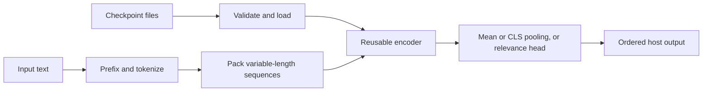

# Architecture

The public `kodamaembed` crate owns tokenization, batching, numerical-mode
selection and fingerprints. Backends consume packed token batches and
produce embeddings or relevance scores.

## Crate boundaries

| Crate | Responsibility |
|---|---|
| [`kodamaembed`](../crates/kodamaembed) | Checkpoint loading, tokenizer configuration, public APIs, batching, streaming and fingerprints |
| [`kodamaembed-model`](../crates/kodamaembed-model) | Shapes, tensor contracts, output modes, calibrated exports and the FP64 reference implementation |
| [`kodamaembed-cpu`](../crates/kodamaembed-cpu) | Portable and SIMD CPU kernels, encoders, INT8 preparation and calibration |
| [`kodamaembed-cuda`](../crates/kodamaembed-cuda) | CUDA driver bindings, GPU storage, FP16 and centered INT8 encoders, embedded PTX |
| [`kodamaembed-vulkan`](../crates/kodamaembed-vulkan) | Vulkan device and resource management, encoders and embedded SPIR-V |
| [`kodamaembed-validate`](../crates/kodamaembed-validate) | Retrieval evaluation and saved-vector comparisons |

## Inference dataflow

Tokenization adds the model's prefix and truncates to its maximum length,
special tokens included. A `tokenizer.json`'s normalizer and pre-tokenizer
run as written, with one exception: a SentencePiece vocabulary under
Metaspace alone splits on whitespace first, as transformers' XLM-R
tokenizer does, and that split replaces the trimming and space-collapsing
steps that close its normalizer. Sequences pack back to back without
padding, and outputs return in input order. Calls with up to 64 texts
tokenize before inference; larger calls and streams tokenize ahead of it
with bounded lookahead.

MPNet models add a learned relative-position bias to every attention layer's
scores. Each backend reads it from one table per model, indexed by a key's
offset from its query, so packed sequences need no masks for it.

ModernBERT's layers normalize before each sublayer, carry no biases and gate
the feed-forward's activated half by its other half. Queries and keys rotate
by their token's position before attention, from cosine and sine tables per
rotation base, and the layers a model's configuration names as local, two of
every three in the published models, score only the keys inside a window
around the query, so their work grows with the sequence and not with its
square. FP16 rounds each rotated and each gated value once: the CUDA and the
Vulkan projections rotate and gate their FP32 sums themselves.

## Numerical modes

Default CPU inference uses FP32. Default CUDA projections use FP16 tensor
products with FP32 accumulation. Rounding a query or key to FP16 drops a small
remainder, which the projection stores beside the FP16 value; attention scores
read both in sequences under 256 tokens and in ModernBERT's windowed layers.
Vulkan runs cooperative-matrix or FP32 shaders by the device's capabilities.

`Precision::Quantized` runs E5-large's centered INT8 preset, one numerical
contract on the CPU and CUDA:

- Projection operands round to FP16 and rotate by fixed signed Hadamard
  transforms in 128-value blocks, following
  [QuaRot](https://arxiv.org/abs/2404.00456).
- Each row subtracts a calibrated static center for its first, last or
  interior token class. Activations quantize with one step per row and half
  of a 128-value block, the 64 inputs of one integer dot, and GPTQ sets the
  weight digits from calibration inputs.
- A projection accumulates exact 64-input integer dots in a fixed FP32 chain
  that restarts at each multiple of the hidden width; the down projection
  joins its segments in a fixed order. The epilogue restores the center's
  projection.
- The last layer's QKV projection and the up projection before it keep a
  second INT8 digit of their operand, on a step 254 times finer; their chain
  runs on through it over the same weight digits.
- The LayerNorms before the feed-forward up projection and later layers' QKV
  projections are deferred into the projection epilogue, after the raw row
  is quantized.
- Attention uses INT8 queries and centered keys, a table of 14-bit weights,
  integer normalization and quantized values; the first and last values keep
  FP16 precision.
- Every reduction is exact or has a prescribed order, so a sequence's vector
  is independent of its batch, and the CPU and CUDA produce the same bits,
  which approximate FP32 inference.

Calibration uses the engine's fixed passages, their openings as queries, and
short queries of vocabulary pieces from a fixed generator. The
[integration guide](integration.md#exact-int8-checkpoints) lists the
checkpoint hashes, the calibration cache and the fingerprints.

## CUDA execution

The centered encoder routes a batch by its total encoded tokens and its
sequences. A batch of up to 16 tokens in at most four sequences can run
every layer in one cooperative launch, a persistent plan with one
384-thread block a streaming multiprocessor. The plan needs at least 40
multiprocessors and cooperative launch; without them, and for other
batches, per-layer kernels run with the same arithmetic. Batches of up to
1,024 tokens replay cached CUDA graphs, and larger ones launch directly.
Driver and allocation errors are returned.

## Ownership and safety

Each `Embedder` or `Reranker` owns its backend, tokenizer pool, weights and
reusable activation storage. Threads share one by reference: the backend sits
behind a lock, and a queue hands the device to callers in arrival order, one
encoder batch at a time. The backend crates' low-level APIs are `unsafe`
where the compiler cannot check a contract: device buffer element types
(`DeviceRepr`), buffers that outlive asynchronous work, CUDA views within
their allocation, kernel arguments, and Vulkan shader, descriptor and command
recording. An unresolved Vulkan submission failure quarantines the device
and keeps its resources until the process exits.
